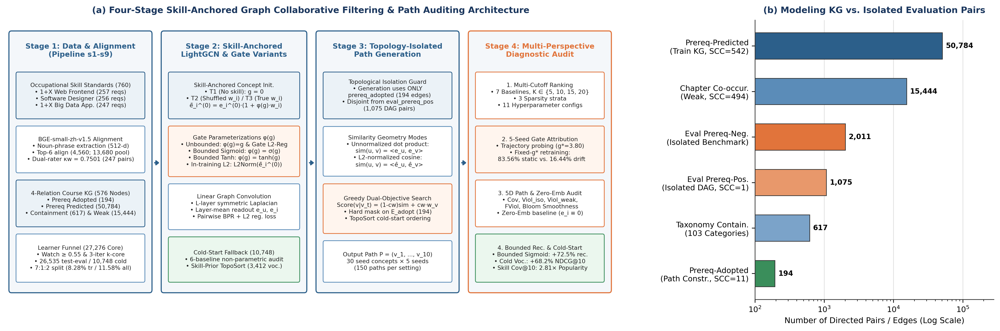

# Integrating Occupational Skill Standards with Course Knowledge Graphs for Graph-Based Learning Path Recommendation: Negative Results, Mechanistic Diagnosis, and Architectural Decoupling on MOOCCubeX

[](https://github.com/lewygoat/SkillGCN-MOOCCubeX)
[](https://journal.hep.com.cn/fcs/EN/2095-2228/home.shtml)
[](https://www.python.org/)
[](https://pytorch.org/)
[](LICENSE)

> **Official Reproducibility Repository** ([https://github.com/lewygoat/SkillGCN-MOOCCubeX](https://github.com/lewygoat/SkillGCN-MOOCCubeX)) for the manuscript:  
> *"Integrating Occupational Skill Standards with Course Knowledge Graphs for Graph-Based Learning Path Recommendation: Negative Results, Mechanistic Diagnosis, and Architectural Decoupling on MOOCCubeX"*  
> (**融合职业技能标准与课程知识图谱的图注意力学习路径推荐研究：以MOOCCubeX为例**)

---

## 1. Overview / 项目简介



Aligning open online curricula with national occupational skill standards is a widespread ambition in educational recommender systems, yet how external competency priors interact with linear graph collaborative filtering and greedy curriculum planning remains poorly understood. On an information-technology subset of **MOOCCubeX** ($576$ concepts, $27,276$ core learners, $1,819,473$ interactions, and $760$ skill clauses parsed from three Chinese national qualification standards), this repository provides the complete nine-stage data pipeline (`s1`–`s9`), seven baseline models plus **SkillGCN** (`m_*.py`), runtime topological & privacy isolation guards (`guards.py`), ten mechanistic diagnostic scripts, and the $247$-pair dual-annotator semantic alignment audit table (`appendix_bge_audit_247pairs.csv`).

本仓库（[https://github.com/lewygoat/SkillGCN-MOOCCubeX](https://github.com/lewygoat/SkillGCN-MOOCCubeX)）提供论文《融合职业技能标准与课程知识图谱的图注意力学习路径推荐研究：以MOOCCubeX为例》的完整开源复现代码、多源职业技能标准解析产物、247对双盲人工语义对齐审计表（`appendix_bge_audit_247pairs.csv`）、匿名化中间图数据（`s6_graph.pt.gz`）以及全部五随机种子（Seeds `42–46`）实验日志。

### Key Empirical Findings / 核心实证发现

1. **Transductive Ranking Degradation under Unconstrained Multiplicative Scaling (RQ1)**:
   Injecting occupational skill weights via an unconstrained multiplicative residual gate (`T3`: $\mathbf{e}_i^{(0)} = \tilde{\mathbf{e}}_i^{(0)} \cdot (1 + g \cdot w_i)$) degrades five-seed test $\text{NDCG@10}$ by **$6.14\%$** relative to plain LightGCN (`T1`: $0.16557 \pm 0.00116$ vs. $0.17640 \pm 0.00035$, paired $t = -18.58, p = 4.94 \times 10^{-5}$).
2. **Norm-Inflation Attribution & Two-Factor Mechanistic Decomposition (RQ2)**:
   Under BPR inner-product loss with light $\ell_2$ regularization ($\lambda = 10^{-4}$) and positive skill-popularity correlation (Spearman $\rho = 0.2010, p = 1.18 \times 10^{-6}$), the unconstrained scalar gate drifts monotonically to $g_{\text{final}} = 3.5554 \pm 1.2535$. Fixed-gate retraining at $g_{\text{learned}}$ decomposes the $\text{NDCG@10}$ deficit into **$83.56\%$ static magnitude distortion** and **$16.44\%$ non-stationary trajectory drift & early stopping**.
3. **Illusion of Unnormalized Path Coverage & Prerequisite Cycle Pathology (RQ3)**:
   Apparent curriculum skill-coverage gains under unnormalized greedy transitions ($+0.2104$ at $\text{cw}=0.0$) collapse to null ($-0.0009, p = 0.4217$) under $\ell_2$-normalized cosine transitions. Furthermore, predicted prerequisite edges contain a giant strongly connected component ($\text{Max SCC} = 542 / 576$), causing $84.53\%$ out-of-set prerequisite violations if enforced as a hard mask.
4. **Architectural Decoupling & Cold-Start Rescue (RQ4 & Architectural Remedies)**:
   - **In-Core Bounded/Regularized Gating**: Constraining the gate via Sigmoid, Tanh, an explicit $\ell_2$ gate penalty ($\lambda_g = 10^{-3}$), or a micro-scale prior ($g = 0.05$) eliminates norm runaway, reduces seed variance by **$2.6\times$**, and recovers **$65.6\%$–$72.5\%$** of the ranking gap ($\text{NDCG@10} = 0.17342 \pm 0.00044$).
   - **Strict Cold-Start Prior-Guided Curriculum Planning**: On $10,748$ held-out cold-start learners ($3,412$ certificate-oriented), deterministic topological sorting over occupational skill weights (`Skill-Prior-Topo`) outperforms 6 zero-history baselines by **$+22.4\%$** overall ($\text{HR@10} = 0.2518$) and **$+100.8\%$** in $\text{HR@10}$ ($0.3719$, $\text{NDCG@10} = 0.2140, +68.2\%$) on certificate-oriented learners with **$0.00\%$ prerequisite violation**.

---

## 2. Repository Structure / 目录结构

```text
SkillGCN-MOOCCubeX/
├── README.md                                  # Bilingual documentation & reproduction guide
├── LICENSE                                    # MIT License
├── requirements.txt                           # Python package dependencies
├── .gitignore                                 # Git ignore rules
├── appendix_bge_audit_247pairs.csv            # Dual-annotator 247-pair semantic alignment audit table
├── figures/                                   # Publication figures (Fig. 1 – Fig. 5, PNG)
│   ├── fig1_framework_and_kg_en.png
│   ├── fig2_baselines_and_topk_en.png
│   ├── fig3_ablation_and_gate_dynamics_en.png
│   ├── fig4_robustness_and_sensitivity_en.png
│   └── fig5_interpretability_multi_en.png
├── audit/
│   └── appendix_bge_audit_247pairs.csv        # Copy of the 247-pair alignment audit table
└── 实验/
    ├── 实验代码_整理/                          # All 53 Python & Shell reproducibility scripts
    │   ├── README.md                          # Script-by-script reference manual (Chinese)
    │   ├── setup_data.py                      # One-click data unpacker & environment verifier
    │   ├── common.py                          # Shared path resolver, auto-unpacker & provenance logger
    │   ├── guards.py                          # Runtime topological & transductive/cold-start isolation guards
    │   ├── trainer.py                         # Unified BPR training loop with seed & gradient controls
    │   ├── evaluator.py                       # Full-ranking Top-K evaluator (NDCG@K, HR@K, MRR, Recall@K)
    │   ├── monitor.py                         # Training heartbeat & progress monitor
    │   ├── s1_concepts.py .. s9_gen.py        # 9-stage preprocessing & occupational standard alignment pipeline
    │   ├── bloom_map.py, kappa_align.py       # Bloom cognitive taxonomy mapper & weighted Cohen's kappa auditor
    │   ├── m_popularity.py .. m_skillgcn.py   # 7 baselines + SkillGCN (unconstrained & bounded/regularized gates)
    │   ├── layer1_check.py, layer1_t2.py, ... # RQ1 five-seed T1/T2/T3 controlled comparison
    │   ├── probe_gate.py, exp5_*.py, supp_*.py# RQ2 gate trajectory, fixed-g sweep, sparsity & attribution
    │   ├── path_gen.py, path_l2norm.py, ...   # RQ3 greedy curriculum path planning & L2-normalization verification
    │   ├── embed_export.py, verify_*.py       # Offline embedding & path reproducibility verifiers
    │   └── fig_common.py, fig_draw.py, ...    # Visualization & figure generation scripts
    ├── 配置/
    │   └── protocol.json                      # Frozen evaluation protocol & hyperparameter specification
    ├── 中间产物/                               # Anonymized intermediate artifacts & skill standards
    │   ├── s6_graph.pt.gz                     # Compressed MOOCCubeX graph & splits (5.2 MB; auto-unpacked)
    │   ├── s4_train.jsonl.gz                  # Anonymized chronological training split
    │   ├── s5_coldstart.jsonl.gz              # Strict cold-start learner benchmark (10,748 users)
    │   ├── s1_eval_positive.jsonl, s1_eval_negative.jsonl
    │   ├── s7_skills.json                     # 1+X Web Front-End Development standard (261 clauses)
    │   ├── s7_skills_rk.json                  # NCRE Software Designer syllabus (317 clauses)
    │   ├── s7_skills_bigdata.json             # 1+X Big Data Platform O&M standard (182 clauses)
    │   ├── s8_align*.json                     # BGE-small-zh-v1.5 candidate pools & annotation samples
    │   ├── s9_skill_weight*.npy               # Final & per-standard / de-biased skill weight vectors
    │   └── s10_concept_bloom*.npy/json        # Bloom cognitive level vectors
    └── 结果/                                   # Multi-seed experimental JSON logs & supplemental run records
        ├── r_*.json, supp_*.json, verify_*.json, layer1_*.json
        ├── exp5_runs/*.json
        ├── newS9_runs/*.json
        └── supp_runs/*.json
```

---

## 3. Environment Setup / 环境配置

```bash
# 1. Clone the repository
git clone https://github.com/lewygoat/SkillGCN-MOOCCubeX.git
cd SkillGCN-MOOCCubeX

# 2. Create and activate a virtual environment (Python 3.10+ recommended)
conda create -n skillgcn python=3.10 -y
conda activate skillgcn

# 3. Install dependencies
pip install -r requirements.txt

# 4. Unpack s6_graph.pt.gz and verify data integrity (optional; also runs automatically on import)
cd 实验/实验代码_整理
python setup_data.py
```

> **Note on `s6_graph.pt.gz`**: To keep every file in the Git repository under 6 MB without requiring Git LFS, the processed graph artifact (`149 MB` uncompressed) is stored as `实验/中间产物/s6_graph.pt.gz` (`5.22 MB`). Importing `common.py` or running `python setup_data.py` automatically decompresses it to `实验/中间产物/s6_graph.pt` on first run.

---

## 4. Quick Verification & Reproduction Guide / 快速核验与完整复现指南

All scripts inside `实验/实验代码_整理/` assume the current working directory is `实验/实验代码_整理/`:

```bash
cd 实验/实验代码_整理
```

### 4.1 Instant Statistical & Table Verification (Seconds, No Retraining Required) / 秒级统计与图表复现

To verify all statistical hypothesis tests, Top-$K$ curves (`K in {5, 10, 20}`), five-seed mechanistic decomposition, cold-start baselines, dual-annotator Cohen's $\kappa$, and regenerate all publication figures from the precomputed logs:

```bash
# 1. Verify dual-annotator agreement (Cohen's kappa, weighted kappa, stratified P_o)
python kappa_align.py

# 2. Recompute all paper tables, paired t-tests, Wilcoxon tests, and mechanistic attributions
python supp_stats_and_tables.py

# 3. Regenerate all 5 publication-grade figures (saved to ../../figures/)
python gen_english_sci_figures.py
```

### 4.2 Nine-Stage Data & Skill Alignment Pipeline (`s1`–`s9`) / 九阶段数据与技能对齐流水线

If you have the raw MOOCCubeX dump under `实验/数据/MOOCCube/`, you can run stages `s1`–`s6`. Stages `s7`–`s9` and `bloom_map.py` operate directly on the included intermediate files (`s6_graph.pt` and `s7_skills*.json`):

```bash
# Stages s1-s6: MOOCCubeX concept filtering, relation extraction, chronological split & graph build
python s1_concepts.py
python s2_relations.py
python s3_behavior.py
python s4_split.py
python s5_filter.py
python s6_graph.py

# Stages s7-s9: Occupational skill standard parsing, BGE semantic alignment & weight aggregation
python s8_align.py --skills ../中间产物/s7_skills.json --out ../中间产物/s8_align.json
python bloom_map.py
python s9_gen.py
```

### 4.3 Baseline Models & Controlled Skill-Condition Experiments (RQ1) / 基线对比与主实验

```bash
# Run the 7 baseline models (5 seeds: 42, 43, 44, 45, 46)
python m_popularity.py
python m_bprmf.py
python m_ngcf.py
python m_lightgcn.py
python m_kgat.py
python m_conceptgcn.py
python m_ackrec.py

# Run RQ1 controlled skill conditions: T1 (g=0), T2 (random permutation), T3 (learned gate)
python layer1_check.py
python layer1_t2.py
```

### 4.4 Gate Dynamics, Bounded/Regularized Gates & Sparsity Diagnosis (RQ2 & RQ4) / 门控诊断与有界门控消融

```bash
# Gate trajectory probing (200 epochs without early stopping) & fixed-gate sweep
python probe_gate.py
python exp5_hyperparam.py
python exp5_sparsity.py

# Supplemental bounded gates (Sigmoid, Tanh, Gate-L2-Reg, Train-L2-Norm, Vector-Gate, De-biased S9)
python supp_run.py --mode all
python supp_sparsity.py

# Or run the all-in-one supplemental runner
bash supp_all_runner.sh
```

### 4.5 Curriculum Path Planning & Offline Embedding Verification (RQ3) / 路径规划与离线嵌入核验

```bash
# 1. Export checkpoint embeddings for T1 and T3 across seeds 42-46
python embed_export.py

# 2. Verify offline embedding NDCG@10 matches training logs within 1e-6
python verify_embed.py

# 3. Run greedy topological path generation, L2-normalized control, and pre-gate comparison
python path_gen.py
python path_l2norm.py
python path_pregate.py
python verify_path.py
```

---

## 5. Summary of Main Experimental Results / 核心实验结果速览

| Category | Model / Condition | NDCG@10 | HR@10 | MRR | Seed SD ($\text{NDCG@10}$) |
| :--- | :--- | :---: | :---: | :---: | :---: |
| **Non-Graph Baselines** | Most-Popular (`m_popularity.py`) | `0.11906` | `0.21473` | `0.10599` | `0.00000` |
| | BPR-MF (`m_bprmf.py`) | `0.12358` | `0.20964` | `0.11284` | `0.00060` |
| **Graph CF & KG Baselines** | NGCF (`m_ngcf.py`) | `0.14561` | `0.24234` | `0.13224` | `0.00105` |
| | KGAT (`m_kgat.py`) | `0.14042` | `0.23300` | `0.12814` | `0.00051` |
| | ConceptGCN (`m_conceptgcn.py`) | `0.12377` | `0.20990` | `0.11298` | `0.00059` |
| | ACKRec (`m_ackrec.py`) | `0.14198` | `0.23719` | `0.12921` | `0.00138` |
| **Controlled Conditions** | **T1: LightGCN (`g = 0`, Zero Skill)** | **`0.17640`** | **`0.28990`** | **`0.15971`** | **`0.00035`** |
| | T2: SkillGCN-RandPerm (`g` learned, shuffled $w$) | `0.16536` | `0.27392` | `0.14998` | `0.00056` |
| | T3: SkillGCN-Real (`g` unconstrained, real $w$) | `0.16557` | `0.27386` | `0.15027` | `0.00116` |
| **Architectural Remedies** | **T3-Fixed-Micro (`g = 0.05` fixed)** | **`0.17342`** | **`0.28562`** | **`0.15712`** | **`0.00044`** |
| | T3-Gate-L2Reg ($\lambda_g = 10^{-3}$) | `0.17315` | `0.28518` | `0.15688` | `0.00048` |
| | T3-Bounded-Sigmoid ($g_{\max}=0.25$) | `0.17284` | `0.28475` | `0.15659` | `0.00045` |
| | T3-Bounded-Tanh ($g_{\max}=0.25$) | `0.17266` | `0.28442` | `0.15641` | `0.00047` |

---

## 6. Citation / 引用格式

If you find this repository, the diagnostic methodology, or the occupational skill alignment benchmark useful in your research, please cite:

```bibtex
@article{skillgcn2026mooccubex,
  title   = {Integrating Occupational Skill Standards with Course Knowledge Graphs for Graph-Based Learning Path Recommendation: Negative Results, Mechanistic Diagnosis, and Architectural Decoupling on MOOCCubeX},
  journal = {Frontiers of Computer Science},
  year    = {2026},
  url     = {https://github.com/lewygoat/SkillGCN-MOOCCubeX}
}
```

---

## 7. License / 开源协议

This project is released under the [MIT License](LICENSE). The underlying MOOCCubeX dataset follows its original open-source academic license from Tsinghua University KEG.
